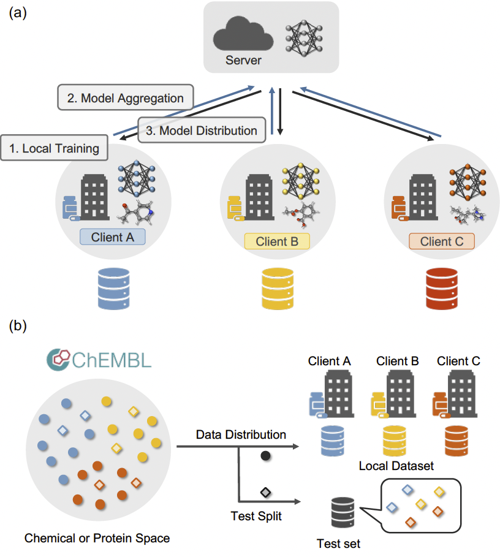

# Empowering Federated Learning for Robust Compound-Protein Interaction Prediction across Heterogeneous Cross-Pharma Domains

**Authors:** Takuto Koyama et al.



--------------------------------------------------------------------------------

This repository contains the code and datasets for the study above. It is built on
[kMoL](https://github.com/elix-tech/kmol), a machine learning library for drug discovery
with federated learning capabilities, using PyTorch and PyTorch Geometric.

Compound-protein interaction is predicted from a graph encoder over the ligand and an
ESM-2 encoder over the target sequence. Federated learning is simulated by partitioning
GPCR activity data across clients that each hold a disjoint set of compounds, under both
homogeneous and heterogeneous partitions at 3, 4 and 5 clients.

## Installation

```bash
make create-env
conda activate kmol
pip install transformers>=4.45.2
```

This project requires `transformers>=4.45.2`.

## Dataset

The federated splits are in `data/FL_31_gpcr/`:

| Directory | Clients | Partition |
|---|---|---|
| `homo_3clients/` `homo_4clients/` `homo_5clients/` | 3 / 4 / 5 | homogeneous — clients hold comparable amounts of data |
| `hetero_3clients/` `hetero_4clients/` `hetero_5clients/` | 3 / 4 / 5 | heterogeneous — client sizes are strongly imbalanced |

Each directory holds one `clusterI.csv.gz` per client plus the configs used below.
`chembl_fl_gpcr_test.csv.gz` is the shared test set. Only the `hetero_*` directories carry
the fine-tuning configs. See `data/FL_31_gpcr/README.md` for details.

## Running

All experiments are driven by JSON configuration files. Paths inside them are relative to
the repository root, so run from there. The example below uses `hetero_3clients`; any
other directory works the same way, with one client per `clusterI.csv.gz`.

### Local baseline

Train and evaluate a single client on its own shard, with no federation:

```bash
kmol train data/FL_31_gpcr/hetero_3clients/graph_ligand+esm_protein_cluster1.json
kmol predict data/FL_31_gpcr/hetero_3clients/graph_ligand+esm_protein_cluster1_predict.json
```

Repeat for `cluster2` and `cluster3`.

### Federated learning

Start the server, then each client in its own shell:

```bash
mila server data/FL_31_gpcr/hetero_3clients/server.json
```

```bash
mila client data/FL_31_gpcr/hetero_3clients/client1.json
mila client data/FL_31_gpcr/hetero_3clients/client2.json
mila client data/FL_31_gpcr/hetero_3clients/client3.json
```

The server waits for all 3 clients, runs 10 rounds, and writes the aggregated model to
`hetero_3clients/server/10.aggregate.pt`. Evaluate it on the shared test set:

```bash
kmol predict data/FL_31_gpcr/hetero_3clients/graph_ligand+esm_protein_fl_predict.json
```

### Fine-tuning the federated model

Fine-tune the aggregated model on one client's shard, then evaluate it:

```bash
kmol train data/FL_31_gpcr/hetero_3clients/client1_finetuning.json
kmol predict data/FL_31_gpcr/hetero_3clients/client1_finetuning_predict.json
```

### Notes

Outputs (checkpoints, logs, aggregated models) are written into the `server/`, `local/`,
`client/`, `clientI/` and `clusterI/` subdirectories of the experiment directory, which
are git-ignored.

Each `server.json` binds a fixed gRPC port, and ports are reused across directories, so
run one experiment at a time or edit `grpc_configuration.target`.

For writing your own configurations, see section 3.4 of `docs/documentation.pdf`, and
sections 3.5.1 and 3.5.2 for the server and client configurations.

## Citation

If you use this work, please cite:

```bibtex
@article{koyama2026empowering,
  title={Empowering federated learning for robust compound-protein interaction prediction across heterogeneous cross-pharma domains},
  author={Koyama, Takuto and Iwata, Hiroaki and Kojima, Ryosuke and Otsuka, Takao and Hasegawa, Aki and Lee, Seungeon and Ueda, Hiroshi and Morimoto, Toshiharu and Sasaki, Ryoko and Torimoto, Nao and others},
  journal={Journal of Cheminformatics},
  volume={18},
  number={1},
  pages={16},
  year={2026},
  publisher={Springer}
}
```
